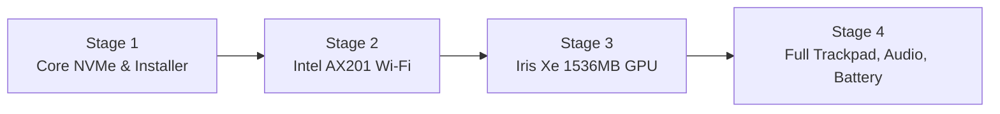

<p align="center">
  <h1 align="center">💻 ASUS VivoBook X421EA / S433EA - OpenCore Hackintosh</h1>
  <p align="center"><b>Complete OpenCore EFI & Post-Install Toolkit for macOS Sequoia 15.x on Intel 11th Gen Tiger Lake</b></p>
</p>

<p align="center">
  <a href="README.md"></a>
  <a href="README_VI.md"></a>
</p>

<p align="center">
  <a href="https://swcdn.apple.com/content/downloads/31/10/142-50013-A_0GMSQ8FVZX/kpmee5466o6dmojjdqw34x6ckj6b332of6/InstallAssistant.pkg"></a>
  <a href="https://github.com/acidanthera/OpenCorePkg"></a>
  <a href="https://github.com/ChefKissInc/WhateverGreen"></a>
  <a href="https://github.com/khoanguyen1808/ASUS-VivoBook-X421EA-Hackintosh/stargazers"></a>
  <a href="https://github.com/khoanguyen1808/ASUS-VivoBook-X421EA-Hackintosh/network/members"></a>
  <a href="https://github.com/khoanguyen1808/ASUS-VivoBook-X421EA-Hackintosh/issues"></a>
</p>

---

## 🌟 Highlights & Why This Repo?

* ⚡ **Intel Iris Xe Hardware Acceleration (QE/CI)**: Custom configured `WhateverXe` kext + graphics package delivering smooth 1536 MB VRAM acceleration on 11th Gen Tiger Lake.
* 🛡️ **4-Stage Progressive Bootloader**: Prevents kernel panics during fresh installation with staged profiles.
* 🤖 **Automation Scripts Included**:
  * `Switch_EFI_Stage.command`: One-click stage switching directly on the mounted EFI partition.
  * `Sync_NVMe_EFI_Clean_Windows.command`: Automatically wipes conflicting Windows EFI boot entries, migrates OpenCore to internal NVMe SSD, disables freezing Bluetooth kexts, and blesses OpenCore into UEFI NVRAM.
* 🚀 **macOS Sequoia 15.x Ready**: Fully configured with `AMFIPass.kext` and `RestrictEvents.kext`.

---

## 💻 Hardware Specifications & Support Status

| Component | Hardware Model | Status | Driver / Patch Applied |
| :--- | :--- | :---: | :--- |
| **Model** | ASUS VivoBook X421EA / S433EA | ✅ Working | MacBookPro16,2 SMBIOS |
| **Processor** | Intel Core 11th Gen (Tiger Lake) | ✅ Working | `CpuTscSync.kext` |
| **iGPU** | Intel Iris Xe Graphics (1536 MB VRAM) | ✅ Working | `WhateverXe.kext` + WhateverXe Graphics PKG |
| **Memory** | DDR4 Dual-Channel | ✅ Working | Native |
| **Storage** | Micron 2210 NVMe 512GB (`MTFDHBA512QFD`) | ✅ Working | `NVMeFix.kext` |
| **Audio** | Realtek ALC256 (Speakers, Headphones, Mic) | ✅ Working | `AppleALC.kext` + `AsusSMC.kext` (Layout-ID 21/11) |
| **Wi-Fi** | Intel Wi-Fi 6 AX201 160MHz | ✅ Working | `itlwm.kext` + **HeliPort** app |
| **Bluetooth** | Intel AX201 Bluetooth | ⚠️ Partial | `IntelBluetoothFirmware` (keep disabled during installation) |
| **Trackpad** | ASUS I2C Precision Multi-touch (`ASUE140C`) | ✅ Working | `VoodooI2C.kext` + `VoodooI2CHID.kext` + `SSDT-GPIO` |
| **Keyboard** | PS/2 Keyboard + Function Fn Keys | ✅ Working | `VoodooPS2Controller.kext` + `BrightnessKeys.kext` |
| **Battery & Sensors**| Battery Indicator, Power Adapter, Ambient Light | ✅ Working | `SMCBatteryManager`, `SMCLightSensor`, `AsusSMC` |
| **USB Ports** | Intel USB 3.1 xHCI Controller | ✅ Working | `USBToolBox.kext` + `UTBMap.kext` |
| **Display Brightness**| Internal Backlight Slider & Shortcuts | ✅ Working | `SSDT-PNLF.aml` |

---

## ⚙️ Recommended BIOS Settings

Restart laptop and press `F2` or `Delete` to enter BIOS Setup:

### 🔴 Disable
* **Fast Boot**
* **Secure Boot**
* **Intel Platform Trust Technology (PTT)** *(optional, recommended if dual-booting)*
* **VMD / Intel RST Storage Controller** *(Must be set to AHCI / NVMe Native Mode)*
* **Wake on LAN / Network Stack**

### 🟢 Enable
* **VT-x**
* **VT-d**
* **Above 4G Decoding**
* **USB Legacy Support**
* **DVMT Pre-Allocated: 64MB or higher**

---

## 📁 Repository Structure

```
ASUS-VivoBook-X421EA-Hackintosh/
├── EFI/
│   ├── BOOT/
│   │   └── BOOTx64.efi
│   └── OC/
│       ├── ACPI/                         # Custom SSDT patches for Tiger Lake
│       ├── Drivers/                      # OpenRuntime, HfsPlus, OpenCanopy...
│       ├── Kexts/                        # Fully verified kext collection for Sequoia
│       ├── Tools/
│       ├── config.plist                  # Active OpenCore configuration
│       ├── config-Stage1-Core-NVMe-Mouse-Keyboard.plist
│       ├── config-Stage2-WiFi.plist
│       ├── config-Stage3-GPU-IrisXe.plist
│       └── config-Stage4-Full-Trackpad-Audio-Battery.plist
├── Post-Install/
│   ├── HeliPort.dmg                      # Status bar Wi-Fi manager for itlwm
│   └── WhateverXe-Graphics/
│       └── WhateverXe-Graphics-0.3.2.pkg # Driver package for Iris Xe acceleration
├── Tools/
│   ├── GenSMBIOS-master/                 # Generate new Serial, MLB, and UUID
│   ├── MountEFI-master/                  # Mount EFI partition with one click
│   ├── ProperTree-master/                # OpenCore-compliant plist editor
│   ├── SSDTTime-master/                  # Dump DSDT & generate custom SSDTs
│   ├── macrecovery/                      # Download official macOS installers
│   ├── ocvalidate                        # Verify config.plist syntax
│   └── USBToolBox_Windows.exe            # Map USB ports on Windows
├── Switch_EFI_Stage.command              # Switch active config stage directly on EFI
├── Sync_NVMe_EFI_Clean_Windows.command   # Sync OpenCore to NVMe & resolve Windows conflicts
└── Hardware_Specs.txt                    # Full hardware PnP dump for ASUS X421EA
```

---

## 🚀 4-Stage Progressive Boot Strategy

Because macOS Sequoia on 11th Gen Tiger Lake requires staged kext loading to prevent installation kernel panics, this EFI uses a **4-stage progressive strategy**:



### 🔹 Stage 1: Core NVMe + USB Mouse + Keyboard (Initial Setup)
* **Config File**: `config-Stage1-Core-NVMe-Mouse-Keyboard.plist`
* **Features**: Micron 2210 NVMe SSD detection, PS/2 keyboard, USB external mouse. Wi-Fi, GPU acceleration, and I2C touch are turned off to ensure 100% stability during macOS installation.

### 🔹 Stage 2: Intel AX201 Wi-Fi
* **Config File**: `config-Stage2-WiFi.plist`
* **Features**: Enables `itlwm.kext`. Install the **HeliPort** app (from `Post-Install/HeliPort.dmg`) to connect to Wi-Fi networks.

### 🔹 Stage 3: Intel Iris Xe Graphics
* **Config File**: `config-Stage3-GPU-IrisXe.plist`
* **Features**: Enables `WhateverXe.kext`. Install `WhateverXe-Graphics-0.3.2.pkg` (from `Post-Install/WhateverXe-Graphics/`) to unlock Full QE/CI Hardware Acceleration (1536 MB VRAM).

### 🔹 Stage 4: Full Features
* **Config File**: `config-Stage4-Full-Trackpad-Audio-Battery.plist`
* **Features**: Multi-touch I2C Trackpad (`VoodooI2C` + `VoodooI2CHID`), Realtek ALC256 Audio (`AppleALC`), Battery status management (`AsusSMC`, `SMCBatteryManager`), and Fn brightness hotkeys.

---

## 🧩 ACPI & Kernel Patches Breakdown

### 1. ACPI DSDT Hotpatches
Configured under `ACPI -> Patch` in `config.plist`:
* **`Fix ASUS S433EA DSDT AE_NOT_FOUND on _SB.PC00.XHCI.RHUB.HS10 -> SS05`**: Prevents ACPI namespace abort error during USB discovery on port HS10/SS05.
* **`Fix ASUS S433EA DSDT AE_NOT_FOUND on _SB.PC00.XHCI.RHUB.HS14 -> SS06`**: Fixes ACPI namespace lookup failure for HS14/SS06 on ASUS Tiger Lake motherboards.

### 2. Custom SSDT Tables
Located in `EFI/OC/ACPI/`:
* **`SSDT-ALS0.aml`**: Adds fake Ambient Light Sensor device for backlight and sleep management.
* **`SSDT-AWAC.aml`**: Disables AWAC clock and forces Legacy RTC on 10th/11th Gen Intel platforms.
* **`SSDT-EC-USBX.aml`**: Injects fake Embedded Controller (`EC`) and defines USB power properties for Sequoia.
* **`SSDT-GPIO.aml`**: Enables Intel Tiger Lake GPIO interrupt controller pin for native I2C Trackpad gestures.
* **`SSDT-PLUG.aml`**: Fixes CPU Power Management (`X86PlatformPlugin`).
* **`SSDT-PMC.aml`**: Restores native NVRAM support on Intel 400/500-series chipsets.
* **`SSDT-PNLF.aml`**: Backlight control fix for Tiger Lake Intel Iris Xe internal display.
* **`SSDT-RHUB.aml`**: Resets USB RHUB controller state for customized port mapping.
* **`SSDT-USBX.aml`**: Injects USB power parameters (`kUSBSleepPowerSupply`, `kUSBWakePowerSupply`).

### 3. Essential Kernel Extensions & Arguments
* **`WhateverXe.kext`**: Tailored Intel Iris Xe graphics driver port for macOS.
* **`AMFIPass.kext`**: Allows AMFI bypass on macOS Sequoia without disabling SIP completely.
* **`RestrictEvents.kext`**: Fixes memory display and model UI strings for modern macOS versions.
* **`NVMeFix.kext`**: Enhances power management and autonomous power state transitions on Micron NVMe SSDs.
* **`ECEnabler.kext`**: Reads battery status across non-standard ACPI Field lengths (> 8 bits).

---

## 🛠 Automation Utilities

### 1. Switch Stage Script (`Switch_EFI_Stage.command`)
Quickly switch the active config file on `/Volumes/EFI`:
```bash
./Switch_EFI_Stage.command
```
Select `1`, `2`, `3`, or `4`. The script replaces `config.plist` and verifies it using `ocvalidate`.

### 2. NVMe Migration Script (`Sync_NVMe_EFI_Clean_Windows.command`)
Once macOS is fully installed:
```bash
./Sync_NVMe_EFI_Clean_Windows.command
```
What it does:
1. Mounts internal NVMe EFI partition.
2. Backs up and removes conflicting `EFI/Microsoft` folder to `~/Windows_EFI_Backup`.
3. Copies OpenCore `EFI/BOOT` and `EFI/OC` to the NVMe drive.
4. Disables conflicting Bluetooth kexts during boot.
5. Blesses OpenCore into UEFI NVRAM.

---

## ⚠️ Important SMBIOS Note

The repository plists include sample `MacBookPro16,2` serial numbers. **Before signing into Apple ID / iCloud / iMessage**, generate your unique SMBIOS:
1. Run `Tools/GenSMBIOS-master/GenSMBIOS.command`.
2. Choose model: **`MacBookPro16,2`**.
3. Open `EFI/OC/config.plist` with **ProperTree** and update `PlatformInfo -> Generic`:
   * `SystemProductName`
   * `SystemSerialNumber`
   * `MLB`
   * `SystemUUID`

---

## ❓ FAQ & Troubleshooting

<details>
<summary><b>1. Stuck at boot on Apple logo or verbose text during install?</b></summary>
Switch back to <b>Stage 1</b> using <code>./Switch_EFI_Stage.command</code>. Stage 1 turns off GPU acceleration and non-essential kexts so the installer boots without hanging.
</details>

<details>
<summary><b>2. Freezes at macOS lockscreen after syncing to NVMe?</b></summary>
Run <code>./Sync_NVMe_EFI_Clean_Windows.command</code>. It automatically disables Intel Bluetooth kexts (<code>IntelBTPatcher</code>, <code>BlueToolFixup</code>) which cause known lockscreen freezes on Sequoia.
</details>

<details>
<summary><b>3. Wi-Fi network list is not showing?</b></summary>
Make sure you switch to <b>Stage 2</b> or higher, then open the <b>HeliPort</b> app located in <code>Post-Install/HeliPort.dmg</code>. <code>itlwm.kext</code> requires HeliPort to connect to SSIDs.
</details>

---

## 👥 Credits & Contributors

Special thanks to all developers and open-source contributors who made Hackintosh on 11th Gen Intel possible:

| Author / Project | Contribution / Component | Link |
| :--- | :--- | :--- |
| **[Acidanthera](https://github.com/acidanthera)** | OpenCorePkg, Lilu, AppleALC, VirtualSMC, CpuTscSync, NVMeFix, RestrictEvents, BrightnessKeys | [GitHub](https://github.com/acidanthera) |
| **[OpenIntelWireless](https://github.com/OpenIntelWireless)** | `itlwm.kext` (Intel Wi-Fi driver) and `HeliPort` client | [GitHub](https://github.com/OpenIntelWireless) |
| **[VoodooI2C Team](https://github.com/VoodooI2C)** (Alexandred, hieplpvip, cholonam, benvs) | `VoodooI2C.kext` & `VoodooI2CHID.kext` (I2C Precision Trackpad) | [GitHub](https://github.com/VoodooI2C) |
| **[ChefKissInc](https://github.com/ChefKissInc)** | `WhateverXe.kext` & WhateverXe Graphics installer (Iris Xe acceleration) | [GitHub](https://github.com/ChefKissInc) |
| **[1Revenger1](https://github.com/1Revenger1)** | `ECEnabler.kext` (Embedded Controller Battery Fix) | [GitHub](https://github.com/1Revenger1/ECEnabler) |
| **[dhinakg](https://github.com/dhinakg)** | `USBToolBox` driver and mapping tools | [GitHub](https://github.com/dhinakg/USBToolBox) |
| **[blusseau](https://github.com/blusseau)** | `AsusSMC.kext` (ASUS Laptop SMC battery, sensors, Fn keys) | [GitHub](https://github.com/blusseau/AsusSMC) |
| **[CorpNewt](https://github.com/corpnewt)** | `GenSMBIOS`, `MountEFI`, `ProperTree`, `SSDTTime` utilities | [GitHub](https://github.com/corpnewt) |
| **[Dortania](https://dortania.github.io)** | OpenCore Install Guide & documentation | [Dortania Guides](https://dortania.github.io) |
| **Apple Inc.** | macOS operating system | [Apple](https://www.apple.com) |

---

## ⭐ Star & Support

If this repository helped you run macOS Sequoia on your ASUS VivoBook, please **give it a Star ⭐** to help other Hackintosh users find it!
