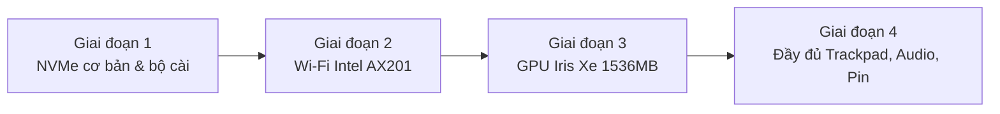

<p align="center">
  <h1 align="center">💻 ASUS VivoBook X421EA / S433EA - OpenCore Hackintosh</h1>
  <p align="center"><b>Bộ công cụ OpenCore EFI & hậu cài đặt hoàn chỉnh cho macOS Sequoia 15.x trên Intel Gen 11 Tiger Lake</b></p>
</p>

<p align="center">
  <a href="README.md"></a>
  <a href="README_VI.md"></a>
</p>

<p align="center">
  <a href="https://swcdn.apple.com/content/downloads/31/10/142-50013-A_0GMSQ8FVZX/kpmee5466o6dmojjdqw34x6ckj6b332of6/InstallAssistant.pkg"></a>
  <a href="https://github.com/acidanthera/OpenCorePkg"></a>
  <a href="https://github.com/ChefKissInc/WhateverGreen"></a>
</p>

---

## 🌟 Điểm nổi bật & Lý do chọn bộ EFI này?

* ⚡ **Tăng tốc phần cứng Intel Iris Xe (QE/CI)**: Kext `WhateverXe` được cấu hình tùy chỉnh cùng gói đồ họa, mang lại khả năng tăng tốc mượt mà với 1536 MB VRAM trên nền tảng Tiger Lake Gen 11.
* 🛡️ **Bootloader tiến trình 4 giai đoạn**: Sử dụng các cấu hình theo từng giai đoạn để ngăn kernel panic khi cài đặt mới.
* 🤖 **Tích hợp tập lệnh tự động hóa**:
  * `Switch_EFI_Stage.command`: Chuyển giai đoạn chỉ với một lần chạy trên phân vùng EFI đã mount.
  * `Sync_NVMe_EFI_Clean_Windows.command`: Tự động xóa các mục khởi động Windows EFI xung đột, chuyển OpenCore sang SSD NVMe nội bộ, tắt các kext Bluetooth gây treo và đăng ký OpenCore vào UEFI.
* 🚀 **Sẵn sàng cho macOS Sequoia 15.x**: Được cấu hình với `AMFIPass.kext` và `RestrictEvents.kext`.

---

## 💻 Thông số phần cứng & tình trạng hỗ trợ

| Thành phần | Phần cứng | Tình trạng | Driver / Bản vá áp dụng |
| :--- | :--- | :---: | :--- |
| **Model** | ASUS VivoBook X421EA / S433EA | ✅ Hoạt động | SMBIOS MacBookPro16,2 |
| **Bộ xử lý** | Intel Core Gen 11 (Tiger Lake) | ✅ Hoạt động | `CpuTscSync.kext` |
| **iGPU** | Intel Iris Xe Graphics (1536 MB VRAM) | ✅ Hoạt động | `WhateverXe.kext` + gói WhateverXe Graphics |
| **Bộ nhớ** | DDR4 Dual-Channel | ✅ Hoạt động | Nhận diện gốc |
| **Ổ cứng** | Micron 2210 NVMe 512GB (`MTFDHBA512QFD`) | ✅ Hoạt động | `NVMeFix.kext` |
| **Âm thanh** | Realtek ALC256 (Loa, tai nghe, mic) | ✅ Hoạt động | `AppleALC.kext` + `AsusSMC.kext` (Layout-ID 21/11) |
| **Wi-Fi** | Intel Wi-Fi 6 AX201 160MHz | ✅ Hoạt động | `itlwm.kext` + ứng dụng **HeliPort** |
| **Bluetooth** | Intel AX201 Bluetooth | ⚠️ Một phần | `IntelBluetoothFirmware` (nên tắt khi cài đặt; có thể gây treo ở màn hình khóa nên không khuyến nghị bật) |
| **Trackpad** | ASUS I2C Precision Multi-touch (`ASUE140C`) | ✅ Hoạt động | `VoodooI2C.kext` + `VoodooI2CHID.kext` + `SSDT-GPIO` |
| **Bàn phím** | Bàn phím PS/2 + phím chức năng Fn | ✅ Hoạt động | `VoodooPS2Controller.kext` + `BrightnessKeys.kext` |
| **Pin & cảm biến** | Chỉ báo pin, bộ sạc, cảm biến ánh sáng môi trường | ✅ Hoạt động | `SMCBatteryManager`, `SMCLightSensor`, `AsusSMC` |
| **Cổng USB** | Intel USB 3.1 xHCI Controller | ✅ Hoạt động | `USBToolBox.kext` + `UTBMap.kext` |
| **Độ sáng màn hình** | Thanh trượt đèn nền tích hợp & phím tắt | ✅ Hoạt động | `SSDT-PNLF.aml` |

---

## ⚙️ Cài đặt BIOS khuyến nghị

Khởi động lại laptop và nhấn `F2` hoặc `Delete` để vào BIOS Setup:

### 🔴 Tắt (Disable)
* **Fast Boot**
* **Vt-d**
* **Secure Boot**
* **Intel Platform Trust Technology (PTT)** *(tùy chọn, khuyến nghị nếu dùng dual-boot)*
* **VMD / Intel RST Storage Controller** *(phải chuyển sang AHCI / NVMe Native Mode)*
* **Wake on LAN / Network Stack**

### 🟢 Bật (Enable)
* **Above 4G Decoding**
* **USB Legacy Support**
* **DVMT Pre-Allocated: 64MB hoặc cao hơn**

---

## 📁 Cấu trúc repository

```
ASUS-VivoBook-X421EA-Hackintosh/
├── EFI/
│   ├── BOOT/
│   │   └── BOOTx64.efi
│   └── OC/
│       ├── ACPI/                         # Các bản vá SSDT tùy chỉnh cho Tiger Lake
│       ├── Drivers/                      # OpenRuntime, HfsPlus, OpenCanopy...
│       ├── Kexts/                        # Bộ kext đã xác minh cho Sequoia
│       ├── Tools/
│       ├── config.plist                  # Cấu hình OpenCore đang dùng
│       ├── config-Stage1-Core-NVMe-Mouse-Keyboard.plist
│       ├── config-Stage2-WiFi.plist
│       ├── config-Stage3-GPU-IrisXe.plist
│       └── config-Stage4-Full-Trackpad-Audio-Battery.plist
├── Post-Install/
│   ├── HeliPort.dmg                      # Ứng dụng quản lý Wi-Fi trên thanh menu cho itlwm
│   └── WhateverXe-Graphics/
│       └── WhateverXe-Graphics-0.3.2.pkg # Gói driver tăng tốc Iris Xe
├── Tools/
│   ├── GenSMBIOS-master/                 # Tạo Serial, MLB và UUID mới
│   ├── MountEFI-master/                  # Mount phân vùng EFI bằng một lần chạy
│   ├── ProperTree-master/                # Trình chỉnh sửa plist tương thích OpenCore
│   ├── SSDTTime-master/                  # Dump DSDT và tạo SSDT tùy chỉnh
│   ├── macrecovery/                      # Tải bộ cài macOS chính thức
│   ├── ocvalidate                        # Kiểm tra cú pháp config.plist
│   └── USBToolBox_Windows.exe            # Map cổng USB trên Windows
├── Switch_EFI_Stage.command              # Chuyển cấu hình giai đoạn đang dùng trên EFI
├── Sync_NVMe_EFI_Clean_Windows.command   # Đồng bộ OpenCore sang NVMe & xử lý xung đột Windows
└── Hardware_Specs.txt                    # Bản dump PnP đầy đủ của ASUS X421EA
```

---

## 🚀 Chiến lược boot tiến trình 4 giai đoạn

Do macOS Sequoia trên Intel Gen 11 Tiger Lake cần nạp kext theo từng giai đoạn để tránh kernel panic khi cài đặt, bộ EFI này sử dụng quy trình tiến trình **4 giai đoạn**:



### 🔹 Giai đoạn 1: NVMe cơ bản + chuột USB + bàn phím (Thiết lập ban đầu)
* **File cấu hình**: `config-Stage1-Core-NVMe-Mouse-Keyboard.plist`
* **Tính năng**: Nhận diện SSD Micron 2210 NVMe, bàn phím PS/2 và chuột USB ngoài. Wi-Fi, tăng tốc GPU và cảm ứng I2C được tắt để đảm bảo ổn định trong quá trình cài đặt macOS.

### 🔹 Giai đoạn 2: Wi-Fi Intel AX201
* **File cấu hình**: `config-Stage2-WiFi.plist`
* **Tính năng**: Bật `itlwm.kext`. Cài ứng dụng **HeliPort** (trong `Post-Install/HeliPort.dmg`) để kết nối mạng Wi-Fi.

### 🔹 Giai đoạn 3: Đồ họa Intel Iris Xe
* **File cấu hình**: `config-Stage3-GPU-IrisXe.plist`
* **Tính năng**: Bật `WhateverXe.kext`. Cài `WhateverXe-Graphics-0.3.2.pkg` (trong `Post-Install/WhateverXe-Graphics/`) để bật tăng tốc phần cứng Full QE/CI (1536 MB VRAM).

### 🔹 Giai đoạn 4: Đầy đủ tính năng
* **File cấu hình**: `config-Stage4-Full-Trackpad-Audio-Battery.plist`
* **Tính năng**: Trackpad I2C đa điểm (`VoodooI2C` + `VoodooI2CHID`), âm thanh Realtek ALC256 (`AppleALC`), quản lý pin (`AsusSMC`, `SMCBatteryManager`) và phím tắt độ sáng Fn.

---

## 🧩 Chi tiết bản vá ACPI & Kernel

### 1. ACPI DSDT Hotpatches
Được cấu hình tại `ACPI -> Patch` trong `config.plist`:
* **`Fix ASUS S433EA DSDT AE_NOT_FOUND on _SB.PC00.XHCI.RHUB.HS10 -> SS05`**: Ngăn lỗi dừng namespace ACPI khi dò cổng USB HS10/SS05.
* **`Fix ASUS S433EA DSDT AE_NOT_FOUND on _SB.PC00.XHCI.RHUB.HS14 -> SS06`**: Sửa lỗi tra cứu namespace ACPI cho HS14/SS06 trên bo mạch ASUS Tiger Lake.

### 2. Các bảng SSDT tùy chỉnh
Nằm trong `EFI/OC/ACPI/`:
* **`SSDT-ALS0.aml`**: Thêm thiết bị cảm biến ánh sáng môi trường giả lập để quản lý đèn nền và chế độ ngủ.
* **`SSDT-AWAC.aml`**: Tắt đồng hồ AWAC và buộc dùng Legacy RTC trên nền tảng Intel Gen 10/11.
* **`SSDT-EC-USBX.aml`**: Tiêm bộ điều khiển nhúng giả (`EC`) và khai báo thuộc tính nguồn USB cho Sequoia.
* **`SSDT-GPIO.aml`**: Bật chân bộ điều khiển ngắt GPIO Intel Tiger Lake cho thao tác cử chỉ trackpad I2C gốc.
* **`SSDT-PLUG.aml`**: Khắc phục quản lý năng lượng CPU (`X86PlatformPlugin`).
* **`SSDT-PMC.aml`**: Khôi phục hỗ trợ NVRAM gốc trên chipset Intel dòng 400/500.
* **`SSDT-PNLF.aml`**: Sửa điều khiển đèn nền màn hình tích hợp Intel Iris Xe trên Tiger Lake.
* **`SSDT-RHUB.aml`**: Đặt lại trạng thái bộ điều khiển USB RHUB để ánh xạ cổng tùy chỉnh.
* **`SSDT-USBX.aml`**: Tiêm thông số nguồn USB (`kUSBSleepPowerSupply`, `kUSBWakePowerSupply`).

### 3. Kext và tham số Kernel quan trọng
* **`WhateverXe.kext`**: Bản chuyển đổi driver đồ họa Intel Iris Xe được tùy chỉnh cho macOS.
* **`AMFIPass.kext`**: Cho phép vượt qua AMFI trên macOS Sequoia mà không cần tắt hoàn toàn SIP.
* **`RestrictEvents.kext`**: Sửa thông tin bộ nhớ và chuỗi model trong giao diện macOS hiện đại.
* **`NVMeFix.kext`**: Tăng cường quản lý năng lượng và chuyển trạng thái nguồn tự động trên SSD Micron NVMe.
* **`ECEnabler.kext`**: Đọc trạng thái pin qua các trường ACPI có độ dài không chuẩn (> 8 bit).

---

## 🛠 Công cụ tự động hóa

### 1. Script chuyển giai đoạn (`Switch_EFI_Stage.command`)
Chuyển nhanh file cấu hình đang dùng trên `/Volumes/EFI`:
```bash
./Switch_EFI_Stage.command
```
Chọn `1`, `2`, `3` hoặc `4`. Script thay thế `config.plist` và kiểm tra bằng `ocvalidate`.

### 2. Script chuyển EFI sang NVMe (`Sync_NVMe_EFI_Clean_Windows.command`)
Sau khi cài đặt macOS hoàn tất:
```bash
./Sync_NVMe_EFI_Clean_Windows.command
```
Script thực hiện:
1. Mount phân vùng EFI của ổ NVMe nội bộ.
2. Sao lưu và xóa thư mục `EFI/Microsoft` xung đột sang `~/Windows_EFI_Backup`.
3. Sao chép `EFI/BOOT` và `EFI/OC` của OpenCore sang ổ NVMe.
4. Tắt các kext Bluetooth xung đột trong quá trình khởi động.
5. Đăng ký OpenCore vào UEFI NVRAM bằng `bless`.

---

## ⚠️ Lưu ý quan trọng về SMBIOS

Các plist trong repository có chứa số serial mẫu `MacBookPro16,2`. **Trước khi đăng nhập Apple ID / iCloud / iMessage**, hãy tạo SMBIOS riêng:
1. Chạy `Tools/GenSMBIOS-master/GenSMBIOS.command`.
2. Chọn model: **`MacBookPro16,2`**.
3. Mở `EFI/OC/config.plist` bằng **ProperTree** và cập nhật tại `PlatformInfo -> Generic`:
   * `SystemProductName`
   * `SystemSerialNumber`
   * `MLB`
   * `SystemUUID`

---

## ❓ FAQ & Khắc phục sự cố

<details>
<summary><b>1. Bị treo ở logo Apple hoặc dòng verbose khi cài đặt?</b></summary>
Chuyển về <b>Giai đoạn 1</b> bằng <code>./Switch_EFI_Stage.command</code>. Giai đoạn 1 tắt tăng tốc GPU và các kext không thiết yếu để bộ cài khởi động mà không bị treo.
</details>

<details>
<summary><b>2. Bị treo ở màn hình khóa macOS sau khi đồng bộ sang NVMe?</b></summary>
Chạy <code>./Sync_NVMe_EFI_Clean_Windows.command</code>. Script tự động tắt các kext Bluetooth Intel (<code>IntelBTPatcher</code>, <code>BlueToolFixup</code>) vốn là nguyên nhân đã biết gây treo màn hình khóa.
</details>

<details>
<summary><b>3. Không thấy danh sách mạng Wi-Fi?</b></summary>
Đảm bảo đã chuyển sang <b>Giai đoạn 2</b> trở lên, sau đó mở ứng dụng <b>HeliPort</b> trong <code>Post-Install/HeliPort.dmg</code>. <code>itlwm.kext</code> cần HeliPort để kết nối với mạng Wi-Fi.
</details>

---

## 👥 Cảm ơn & Người đóng góp

Xin chân thành cảm ơn các nhà phát triển và cộng đồng mã nguồn mở đã giúp Hackintosh trên Intel Gen 11 trở nên khả thi:

| Tác giả / Dự án | Thành phần đóng góp | Đường dẫn |
| :--- | :--- | :--- |
| **[Acidanthera](https://github.com/acidanthera)** | OpenCorePkg, Lilu, AppleALC, VirtualSMC, CpuTscSync, NVMeFix, RestrictEvents, BrightnessKeys | [GitHub](https://github.com/acidanthera) |
| **[OpenIntelWireless](https://github.com/OpenIntelWireless)** | `itlwm.kext` (driver Wi-Fi Intel) và ứng dụng `HeliPort` | [GitHub](https://github.com/OpenIntelWireless) |
| **[VoodooI2C Team](https://github.com/VoodooI2C)** (Alexandred, hieplpvip, cholonam, benvs) | `VoodooI2C.kext` & `VoodooI2CHID.kext` (trackpad I2C Precision) | [GitHub](https://github.com/VoodooI2C) |
| **[b00t0x](https://github.com/b00t0x)** | Bộ cài WhateverXe Graphics (tăng tốc Iris Xe) | [GitHub](https://github.com/b00t0x) |
| **[1Revenger1](https://github.com/1Revenger1)** | `ECEnabler.kext` (bản vá pin Embedded Controller) | [GitHub](https://github.com/1Revenger1/ECEnabler) |
| **[dhinakg](https://github.com/dhinakg)** | Driver `USBToolBox` và công cụ ánh xạ cổng | [GitHub](https://github.com/dhinakg/USBToolBox) |
| **[blusseau](https://github.com/blusseau)** | `AsusSMC.kext` (pin, cảm biến và phím Fn cho laptop ASUS) | [GitHub](https://github.com/blusseau/AsusSMC) |
| **[CorpNewt](https://github.com/corpnewt)** | Công cụ `GenSMBIOS`, `MountEFI`, `ProperTree`, `SSDTTime` | [GitHub](https://github.com/corpnewt) |
| **[Dortania](https://dortania.github.io)** | Hướng dẫn cài đặt OpenCore và tài liệu | [Dortania Guides](https://dortania.github.io) |
| **Apple Inc.** | Hệ điều hành macOS | [Apple](https://www.apple.com) |

---

## ⭐ Ủng hộ dự án

Nếu repository này giúp bạn chạy macOS Sequoia trên ASUS VivoBook, hãy **nhấn Star ⭐** để những người dùng Hackintosh khác dễ dàng tìm thấy dự án!
